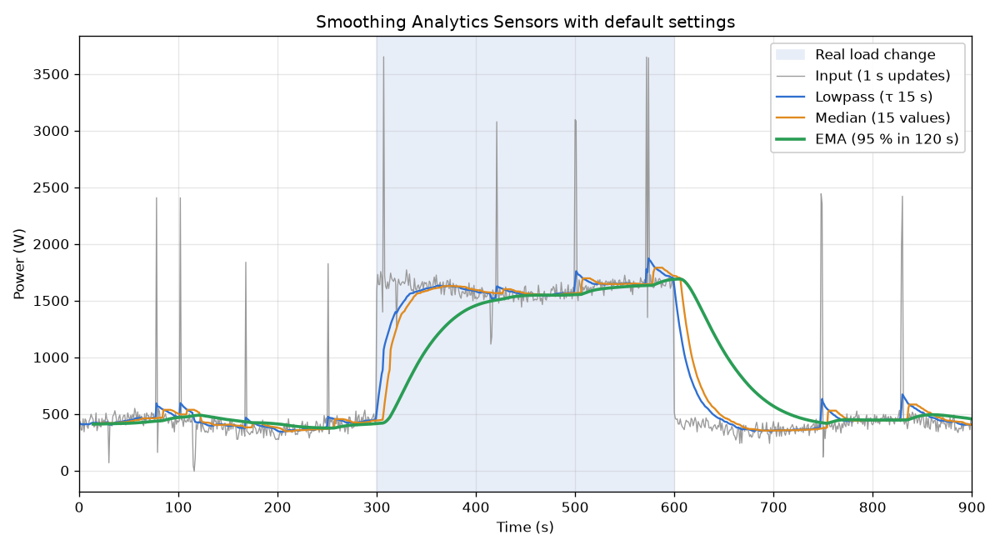

# Smoothing Analytics Sensors

[![GitHub Release][releases-shield]][releases]
[![GitHub Downloads][downloads-shield]][downloads]
[![License][license-shield]][license]
[![BuyMeCoffee][buymecoffeebadge]][buymecoffee]

Smooth any numeric Home Assistant sensor so short spikes do not drive your automations.
SAS feeds the sensor through three filters in a row and gives you a sensor for each step.

**Documentation:** [Wiki](https://github.com/woopstar/smoothing_analytics_sensors/wiki)

## How It Works

| Step | Sensor  | Default       | Role                                                 |
| ---- | ------- | ------------- | ---------------------------------------------------- |
| 1    | Lowpass | τ 15 s        | Removes fast noise. Spikes become small bumps        |
| 2    | Median  | 15 values     | Cuts bumps shorter than half the window              |
| 3    | EMA     | 95 % in 120 s | Final smoothing. Follows real changes, ignores bumps |

- All filters are time-based. The response time is in seconds, whatever the input's update rate.
- Use the EMA for automations. Use lowpass or median when you need a faster reaction.
- An unavailable input makes all three sensors unavailable. Values survive restarts.

Details: [Visualization](docs/visualization.md) · [Filter math](docs/filter-math.md) ·
[Sensors reference](docs/sensors-reference.md)

## Why Not the Built-In Helpers?

Home Assistant has **Filter** and **Statistics** helpers. SAS adds what they lack:

| Need                   | HA Filter / Statistics                           | SAS                                   |
| ---------------------- | ------------------------------------------------ | ------------------------------------- |
| Response time          | Filter lowpass counts state changes              | Real seconds, at any update rate      |
| EMA with a known delay | No                                               | 95 % of a step after a set time       |
| Chain of filters in UI | One filter or value per helper, chains need YAML | Three stages, a sensor for each       |
| Change the input       | New helper                                       | Reconfigure keeps entity IDs, history |

Need one moving average, a range or an outlier filter? The built-in helpers are enough.
More: [Why SAS](docs/why-sas.md)

## Installation

Requires Home Assistant 2024.11 or newer.

**Marketplace (Home Assistant 2026.11+)**

1. **Settings → Marketplace → Add from link**.
2. Paste `https://github.com/woopstar/smoothing_analytics_sensors` as **Integration**.
3. Download and restart Home Assistant. HACS installs migrate on their own.

**HACS (Home Assistant 2026.10 and older)**

1. HACS → **⋮ → Custom repositories**.
2. Add `https://github.com/woopstar/smoothing_analytics_sensors` as **Integration**.
3. Install **Smoothing Analytics Sensors** and restart Home Assistant.

**Manual:** copy `custom_components/smoothing_analytics_sensors` into your `custom_components`
folder and restart.

More: [Installation](docs/installation.md)

## Setup

SAS is a helper: **Settings → Devices & services → Helpers → Create helper → Smoothing Analytics
Sensors**

| Field                         | Default                     | Range      |
| ----------------------------- | --------------------------- | ---------- |
| Input sensor                  | —                           | any sensor |
| Name                          | Smoothing Analytics Sensors | text       |
| Lowpass time constant (s)     | 15                          | 1–3600     |
| Median sampling size (values) | 15                          | 1–60       |
| EMA desired time to 95 % (s)  | 120                         | 10–600     |

- One entry per input sensor.
- **Configure** changes name and filter settings. **Reconfigure** swaps the input sensor and keeps
  entity IDs and history.

More: [Configuration](docs/configuration.md) with presets for slow sensors ·
[Troubleshooting](docs/troubleshooting.md)

## Background

SAS grew out of the
[Huawei Solar Battery Optimization Project](https://github.com/heinoskov/huawei-solar-battery-optimizations),
where smoothed house load drives battery decisions. The same filters work for any fluctuating
sensor: power, temperature, prices.

A simple moving average was not used: it weights all values equally, reacts slower than an EMA
and does not remove spikes like a median.

[releases-shield]: https://img.shields.io/github/v/release/woopstar/smoothing_analytics_sensors?style=for-the-badge
[releases]: https://github.com/woopstar/smoothing_analytics_sensors/releases
[downloads-shield]: https://img.shields.io/github/downloads/woopstar/smoothing_analytics_sensors/total.svg?style=for-the-badge
[downloads]: https://github.com/woopstar/smoothing_analytics_sensors/releases
[license-shield]: https://img.shields.io/github/license/woopstar/smoothing_analytics_sensors?style=for-the-badge
[license]: https://github.com/woopstar/smoothing_analytics_sensors/blob/main/LICENSE
[buymecoffeebadge]: https://img.shields.io/badge/buy%20me%20a%20coffee-donate-FFDD00.svg?style=for-the-badge&logo=buymeacoffee
[buymecoffee]: https://www.buymeacoffee.com/woopstar
