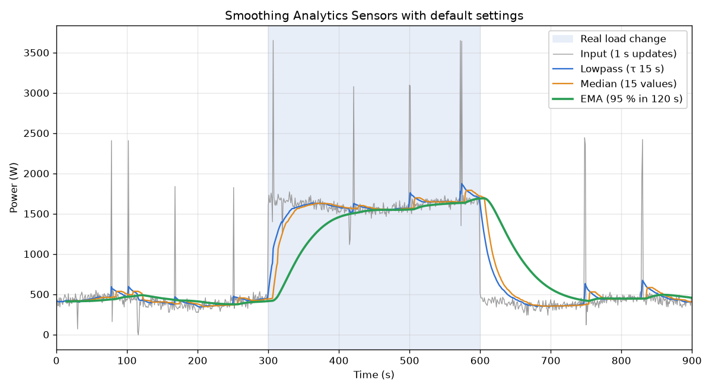

# Visualization

How the three stages behave on grid power with 1-second updates and the default settings.



| Line            | Setting                  | What it shows                                                 |
| --------------- | ------------------------ | ------------------------------------------------------------- |
| Input (gray)    | 1 s updates              | Base load with noise, short appliance spikes, one real change |
| Lowpass (blue)  | τ 15 s                   | Noise is gone. Spikes become small bumps                      |
| Median (orange) | 15 values                | Bumps shorter than half the window are cut further            |
| EMA (green)     | 95 % in 120 s            | Ignores the bumps, follows the real change within about 2 min |
| Blue band       | 300–600 s, about +1.2 kW | A sustained load change that the EMA should follow            |

Read the figure from left to right:

- **0–300 s:** spikes up to +2 kW last 1–3 s. The EMA barely moves.
- **300 s:** a real load change. Lowpass and median follow within about 45 s. The EMA reaches
  95 % about 120 s after the median.
- **600 s:** the load drops back. Same delays in the other direction.

For formulas and response times see [Filter math](filter-math.md). For other update rates see
the presets in [Configuration](configuration.md#presets).

## Regenerate the Figure

`scripts/plot_filters.py` loads `filters.py` from the integration, so the figure always uses the
same math as the sensors:

```bash
uv run --no-project --with matplotlib python scripts/plot_filters.py
```

It writes `assets/visualization.png`. Run it in the same PR as any change to `filters.py` or to
the defaults in `const.py`.
